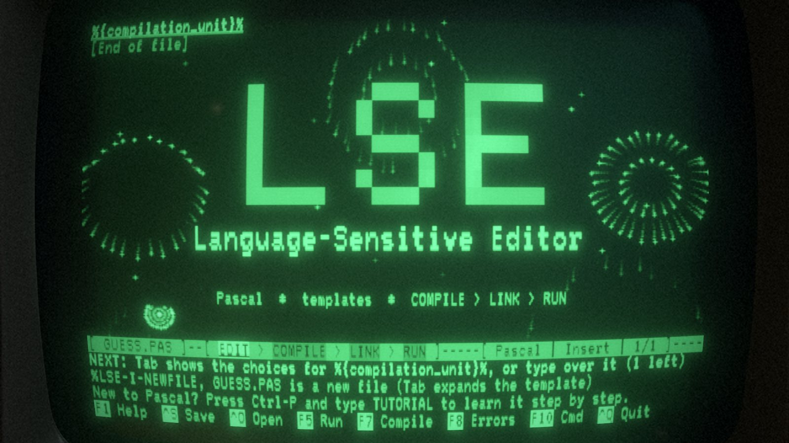
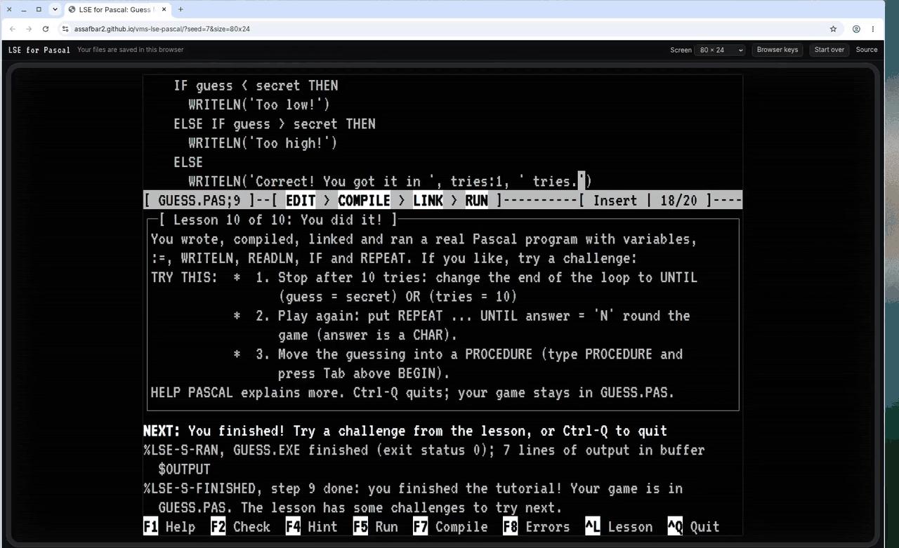
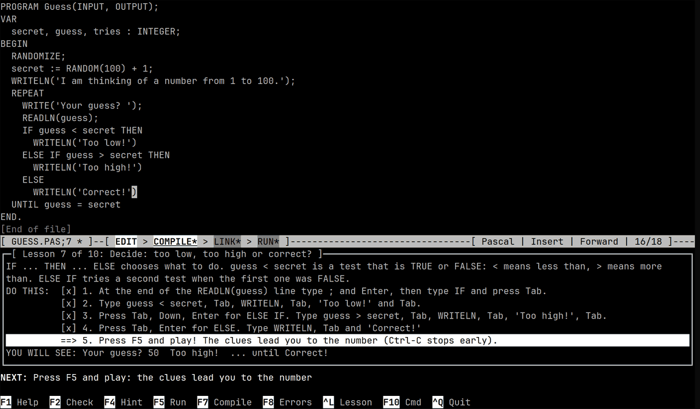
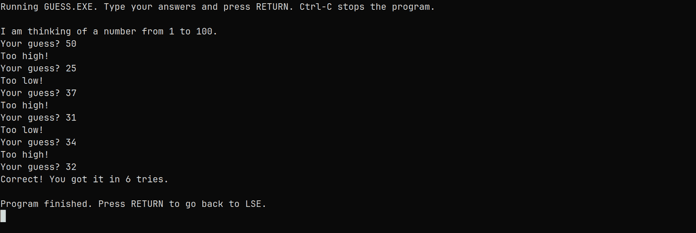
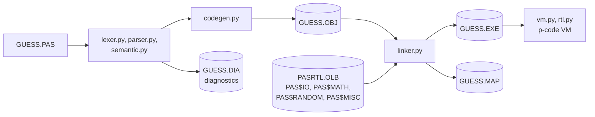
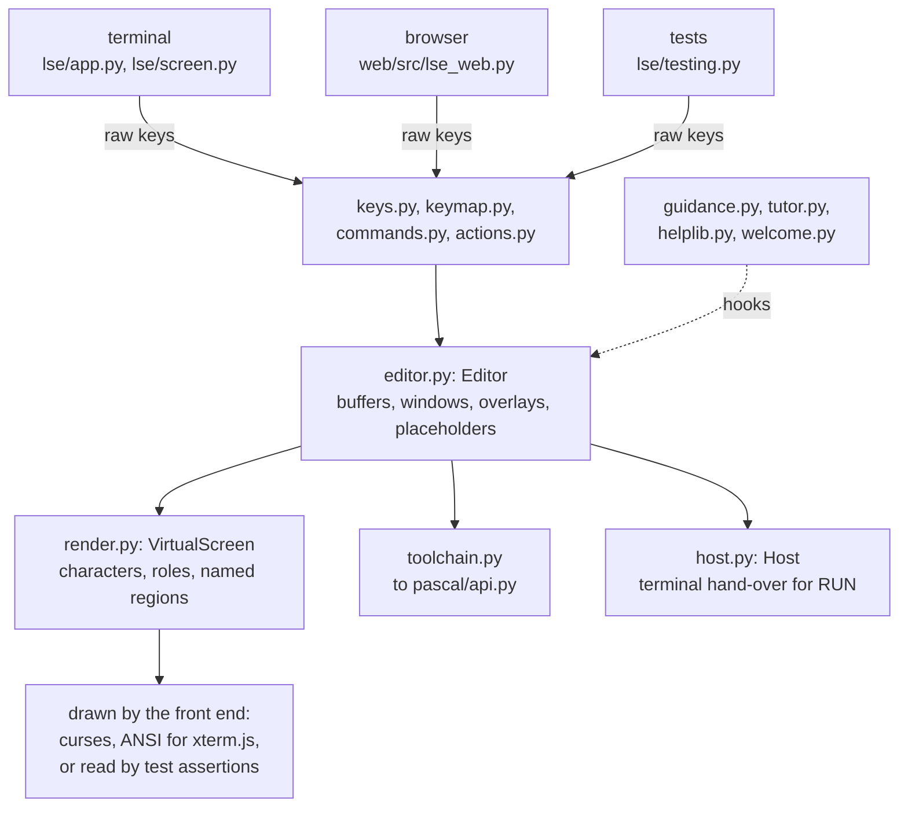
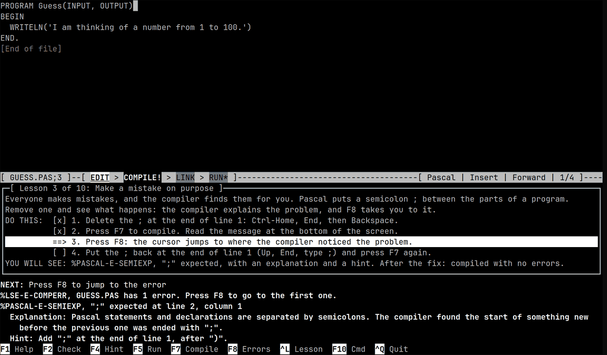

<h1 align="center">vms-lse-pascal</h1>

<p align="center">
  The VAX/VMS Language-Sensitive Editor, rebuilt for Pascal, with a real toolchain behind it:<br>
  a compiler that writes object modules, a linker that writes VMS-style maps, and a p-code VM with symbolic tracebacks.
</p>

<p align="center">
  <a href="https://github.com/assafbar2/vms-lse-pascal/actions/workflows/tests.yml"></a>
  <a href="https://github.com/assafbar2/vms-lse-pascal/actions/workflows/pages.yml"></a>
  <a href="pyproject.toml"></a>
  <a href="LICENSE"></a>
</p>

<p align="center">
  <b><a href="https://assafbar2.github.io/vms-lse-pascal/">Run it in the browser</a></b>
  &nbsp;·&nbsp; <a href="#quick-start">Quick start</a>
  &nbsp;·&nbsp; <a href="#architecture">Architecture</a>
  &nbsp;·&nbsp; <a href="#what-the-toolchain-prints">Messages, maps, tracebacks</a>
  &nbsp;·&nbsp; <a href="#testing">Testing</a>
</p>

<!-- VIDEOS:START -->
<!-- The poster and the three video links point at the demo-videos release assets.
     Replace each href with its YouTube URL once the videos are uploaded. -->
### Videos

<p align="center">
  <a href="https://github.com/assafbar2/vms-lse-pascal/releases/download/demo-videos/lse-intro-v2.mp4"> COMPILE > LINK > RUN status line. Links to the intro video."></a>
</p>

| Video | Length | What it shows |
| --- | --- | --- |
| [**Intro**](https://github.com/assafbar2/vms-lse-pascal/releases/download/demo-videos/lse-intro-v2.mp4) (MP4, 68 MB) | 0:40 | The real editor, captured key by key and composited onto a CRT: templates expand into `GUESS.PAS`, then `COMPILE`, `LINK`, `RUN` |
| [**Browser demo**](https://github.com/assafbar2/vms-lse-pascal/releases/download/demo-videos/lse-web-demo.mp4) (MP4, 7 MB) | 1:28 | Google Chrome on the live site, from page load through the tutorial to a won game |
| [**Terminal tutorial**](https://github.com/assafbar2/vms-lse-pascal/releases/download/demo-videos/lse-tutorial-demo.mp4) (MP4, 9 MB) | 4:18 | The ten-step tutorial in xfce4-terminal, from an empty file to a won game |

The poster links to the intro. All three files are assets of the [demo-videos release](https://github.com/assafbar2/vms-lse-pascal/releases/tag/demo-videos).
<!-- VIDEOS:END -->

## What this is

LSE was DEC's template-driven editor on VMS: type a keyword, expand it, and get a template with the cursor on its first placeholder. Here, `WHILE` expands to `WHILE %{boolean_expression}% DO %{statement}%`. This repository rebuilds that workflow for a teaching subset of Pascal and puts a complete, inspectable toolchain behind it. Everything the toolchain writes is plain text, so each step can be opened and read.

- **Editor (`lse/`).** Templates and placeholders from an LSE-style language definition file, the `LSE>` command line with VMS abbreviations, versioned saves (`GUESS.PAS;1`, `;2`, ...), REVIEW of compiler diagnostics, two windows, and VT220, amber and green themes.
- **Toolchain (`pascal/`).** A recursive-descent compiler that emits p-code into a text `.OBJ`; a linker that resolves `[EXTERNAL]` references against `[GLOBAL]` symbols and the run-time library `PASRTL.OLB`, and writes `.EXE` and `.MAP`; a stack VM. All 120 messages use the `%FACILITY-L-IDENT` format and come with an explanation and a hint.
- **Guidance and tutorial.** A NEXT line computed from editor state, an `EDIT > COMPILE > LINK > RUN` indicator, a context-sensitive key bar, and a ten-step tutorial that builds a Guess My Number game.
- **Browser build (`web/`).** The same Python packages, unmodified, on Pyodide in a Web Worker with xterm.js. Every push to `main` is deployed to GitHub Pages.

There are no runtime dependencies beyond the Python 3.11+ standard library (plus `windows-curses` on Windows). The code is about 6,800 lines in `pascal/` and 9,000 in `lse/`, with 6,000 lines of tests.

## Quick start

### In the browser

Open <https://assafbar2.github.io/vms-lse-pascal/>. It starts in the tutorial; there is nothing to install. It runs in current Chrome, Edge, Firefox and Safari on desktop.

- The first visit downloads about 14 MB and reloads once, while a service worker turns on cross-origin isolation (needed for a running program to block in `READLN`). Later visits load from the browser cache.
- Files (`GUESS.PAS;n`, tutorial progress, `EXAMPLES/`) are kept in IndexedDB. **Start over** erases them.
- Browsers reserve some keys. Click a label in the key bar to press that key, press **Esc then a digit** for an F-key (Esc 5 = F5), and use **Alt-W**, **Alt-N** and **Alt-Q** in place of Ctrl-W, Ctrl-N and Ctrl-Q.
- URL options: `?theme=AMBER` or `GREEN`, `?size=80x24`, `132x24` or `fit`, and `?seed=7` for repeatable `RANDOM`.

<p align="center"></p>

### In a terminal

```sh
git clone https://github.com/assafbar2/vms-lse-pascal.git
cd vms-lse-pascal
pipx install .            # or: uv tool install .   or: pip install -e .
mkdir ~/pascal && cd ~/pascal
lse                       # starts the tutorial and writes GUESS.PAS here
```

`pipx install git+https://github.com/assafbar2/vms-lse-pascal` works too, without a checkout. Installing provides `lse` (the editor) and the toolchain commands `pascal`, `link` and `run`, plus `paslink` and `pasrun` in case `link` clashes with the Unix command. Without installing, use `python -m lse` and `python -m pascal PASCAL|LINK|RUN ...` from the repository root.

```
lse                  the tutorial (resumes where you left off); a welcome screen once it is finished
lse GUESS.PAS        edit a file; a new .PAS file starts as a template
lse --tutorial       the tutorial, even if it was finished before
lse --no-tutorial    the welcome screen: tutorial, new file, open file, quit
lse --keytest        show which keys the terminal lets through
lse --theme AMBER    amber (or GREEN) phosphor instead of VT220 white
lse --seed 7         make RANDOM repeatable in every RUN
```

The toolchain also runs on its own, from any shell:

```sh
$ cd examples
$ pascal HELLO                  # HELLO.PAS -> HELLO.OBJ, HELLO.DIA
$ link HELLO                    # HELLO.OBJ + PASRTL.OLB -> HELLO.EXE, HELLO.MAP
$ run HELLO
Hello, world!
$ pascal /LIST HELLO            # also writes the listing HELLO.LIS
$ pascal MATHLIB && pascal MATHDEMO && link MATHDEMO, MATHLIB
$ run /SEED=7 /INPUT=answers.txt GUESS   # repeatable RANDOM, input from a file
```

Qualifiers can be written VMS style (`/LIST`, `/SEED=42`, or attached as `HELLO/LIST`) or Unix style (`--list`, `--seed 42`). `/NOEXPLAIN` drops the explanation and hint under each message.

## Using the editor

<p align="center"></p>

- **Status line:** the file and its version, then the build cycle. A stage marked `*` is stale (the source changed since it ran) and `!` means it failed.
- **NEXT line:** the next action and the key that does it, whether or not the tutorial is running.
- **Message line:** VMS-style messages with an explanation and a hint. `SET MESSAGES /NOEXPLAIN` turns the explanations off.
- **Key bar:** the keys that apply right now (menu keys inside a menu, error keys inside REVIEW). The way out, `^Q Quit` or `Esc`, is always on it. Ctrl-P or F10 replaces it with the `LSE>` prompt.

| Key | Does |
| --- | --- |
| Tab | expand the placeholder or template word at the cursor (or open its menu); otherwise go to the next placeholder |
| Shift-Tab, Ctrl-N | previous / next placeholder without expanding |
| Ctrl-K, Ctrl-Delete | erase a placeholder (an optional one takes its `;` or `,` with it) |
| F1 | explain the placeholder or word at the cursor; elsewhere WHAT NOW and the VT220 keypad |
| F2, F4, F6 | tutorial: check the step, hint (press again for more, then "show me"), list the steps |
| F5 / F7 | compile, link and run / compile only |
| F8, Shift-F8 | next / previous compiler message, in the source |
| F10, Ctrl-P | the `LSE>` command line (Tab completes commands and file names) |
| Ctrl-S | save as a new version (`GUESS.PAS;1`, `;2`, ...) |
| Ctrl-O, Ctrl-Q | open a file, quit (asks first if something is unsaved) |
| Ctrl-Z, Ctrl-Y | undo, redo |
| Ctrl-F, F3, Ctrl-G | find, find next, go to line |
| Ctrl-W, Ctrl-B, Ctrl-L | other window, buffer list, hide or show the lesson |

If the terminal keeps a key for itself (GNOME Terminal takes F1 and F10), press **Esc then the digit**: Esc 5 = F5, Esc 0 = F10. Every key is also an `LSE>` command (`HELP KEYS` lists them). LSE puts the terminal in raw mode, so Ctrl-S and Ctrl-Q reach it instead of acting as flow control.

**Templates and placeholders.** `%{name}%` must be filled in, `%[name]%` is optional, and a trailing `...` means it can repeat; Pascal already uses `{ }` and `[ ]`, so these are LSE's alternate delimiters. In a new file, Tab on `%{compilation_unit}%` gives a program outline. Typing `IF`, `WHILE`, `REPEAT` or `WRITELN` and pressing Tab expands that template; Tab then moves from blank to blank. The message line explains the placeholder under the cursor and F1 shows its full description with an example. `SHOW TOKENS` and `SHOW PLACEHOLDERS` list them; the definitions are in [`lse/languages/pascal.lse`](lse/languages/pascal.lse):

```
DEFINE TOKEN WHILE /LANGUAGE=PASCAL
  "WHILE %{boolean_expression}% DO"
  "  %{statement}%"
END DEFINE
```

**Compile, link and run.** F7 saves and compiles; diagnostics go to REVIEW, and F8 steps through them in the source. A placeholder left in the program is reported as `%PASCAL-E-PLACEHOLDER`, so F8 finds it too. F5 compiles, links and runs: the screen is handed to the program between two banners, a letter typed where a number is expected is explained and asked again, and the output is kept in the buffer `$OUTPUT`. `LINK` writes `GUESS.MAP`; Ctrl-O `GUESS.MAP` opens it read-only.

<p align="center"></p>

**The tutorial.** Ten steps build `GUESS.PAS`: an empty program, `WRITELN`, a deliberate mistake and F8, variables, `RANDOM` and the link map, a `REPEAT` loop with `READLN`, `IF ... ELSE IF ... ELSE`, counting tries, playing, and challenges. Each step lists the exact keys (DO THIS) and the expected result (YOU WILL SEE), ticks actions off as they happen, and advances when its checks pass. F4 escalates from a hint to the exact keys to "show me" (which inserts the step's program; Ctrl-Z takes it back). If something an earlier step built goes missing, the NEXT line says so. Progress is saved in `GUESS.TUT`. Lessons are data: [`lse/lessons/guess.lesson`](lse/lessons/guess.lesson), with the format documented in [`lse/lesson.py`](lse/lesson.py).

**Help and commands.** `HELP PASCAL` opens a VMS-style hierarchical help library (`HELP PAS LOOP WHILE` works, abbreviated) with topics from PROGRAM to COMPILE-LINK-RUN, and `HELP PASCAL MESSAGES` explains every message. `WHAT NOW` describes the current state ("It compiled, but it hasn't been linked since your last change") and names the key to press. Other commands include `SET THEME VT220|AMBER|GREEN`, `SET LINE_DRAWING ACS|UNICODE|ASCII`, `TWO WINDOWS`, `GOTO LINE n`, `PURGE /KEEP=n`, `TUTORIAL [OFF|RESTART|STEP n]` and `EXIT`; `HELP COMMANDS` lists them all.

## Architecture

Two Python packages with one narrow boundary between them. `pascal/` is a conventional compile, link and run pipeline that works from any shell. `lse/` is an editor core with no terminal dependency, and three front ends drive it: curses, the browser, and the test harness.



### Toolchain pipeline

| Stage | Module | Output |
| --- | --- | --- |
| Lex, parse | [`lexer.py`](pascal/lexer.py), [`parser.py`](pascal/parser.py) | AST ([`astnodes.py`](pascal/astnodes.py)); the parser continues after errors and accepts placeholders wherever a name, type, statement or expression can appear, so a half-finished template still yields a tree the tutor can check |
| Check | [`semantic.py`](pascal/semantic.py), [`types.py`](pascal/types.py) | symbol tables, type checking, static and frame storage allocation |
| Generate | [`codegen.py`](pascal/codegen.py) | p-code with symbolic references to externals |
| Compile driver | [`compiler.py`](pascal/compiler.py) | `.OBJ`, `.DIA` (LSE diagnostics format, read by REVIEW), `.LIS` with `/LIST` |
| Link | [`linker.py`](pascal/linker.py) | `.EXE` image and `.MAP` |
| Run | [`vm.py`](pascal/vm.py), [`rtl.py`](pascal/rtl.py) | program output; `%PAS-F-...` plus a traceback on a fatal error |

The editor never imports the compiler, linker or VM directly. It goes through [`pascal/api.py`](pascal/api.py) (`parse_source`, `compile_file`, `link`, `run_image`, `get_message`), and the editor tests substitute a fake with the same functions.

### Object modules: `.OBJ`

An object module is a readable text file: module header, a `GLOBALS` table of symbols it defines, an `EXTERNALS` table of symbols it needs together with every fixup site (the addresses of the instructions that refer to them), debug records for routines, variables and source lines, and the code. Addresses are module-relative and hexadecimal. This is `GUESS.OBJ`, abridged:

```
.MODULE    GUESS
.KIND      PROGRAM
.SOURCE    'GUESS.PAS'
.DATA      0003                 ; cells of static data
.TRANSFER  0000                 ; main program entry point
.GLOBALS                        ; symbols defined here for other modules
.EXTERNALS                      ; symbols needed from elsewhere, and where they are used
  PAS$RANDOMIZE        ROUTINE  'PROCEDURE'  0002
  PAS$RANDOM           ROUTINE  'FUNCTION(INTEGER):INTEGER'  0005
  PAS$WRITE_STR        ROUTINE  'PROCEDURE(STRING,INTEGER)'  000E 0014 0025 0030 0037 003F
  PAS$READ_INT         ROUTINE  'FUNCTION:INTEGER'  0016
  ...
.VARIABLES                      ; debug: owning routine (* = static), name, offset, cells
  *      SECRET               0000 1
  *      GUESS                0001 1
  *      TRIES                0002 1
.CODE
  0000  ENTER  0                            ; temporaries of the main program
  0001  MARK   0
  0002  CALL   PAS$RANDOMIZE 0
  0003  MARK   0
  0004  LIT    100
  0005  CALL   PAS$RANDOM 1                 ; RANDOM(n): 0..n-1
  0006  LIT    1
  0007  ADDI
  0008  STG    0000                         ; SECRET
  ...
  001E  LDG    0001                         ; GUESS
  001F  LDG    0000                         ; SECRET
  0020  LES
  0021  JPF    0029                         ; IF condition false
  ...
  0045  JPF    0011                         ; repeat UNTIL the condition is TRUE
  0046  STOP                                ; end of program
.LINES                          ; debug: first address of each source line
  0000 4
  0001 5
  0003 6
  ...
```

A `MODULE` exports with `[GLOBAL]` and a program imports with `[EXTERNAL]`, VAX Pascal style. Each external carries its type signature, and the linker checks it:

```
; MATHLIB.OBJ
.GLOBALS
  SQUARE               ROUTINE  0000  'FUNCTION(INTEGER):INTEGER'
  GCD                  ROUTINE  000A  'FUNCTION(INTEGER,INTEGER):INTEGER'
  PRINTBAR             ROUTINE  001F  'PROCEDURE(INTEGER)'
  CALLCOUNT            DATA     0000  'INTEGER'
; MATHDEMO.OBJ
.EXTERNALS
  CALLCOUNT            DATA     'INTEGER'  0002 003F
  SQUARE               ROUTINE  'FUNCTION(INTEGER):INTEGER'  0018 0022
  PRINTBAR             ROUTINE  'PROCEDURE(INTEGER)'  0023
  GCD                  ROUTINE  'FUNCTION(INTEGER,INTEGER):INTEGER'  0035
  ...
```

A mismatch between the two is `%LINK-E-SIGNATURE`; a symbol defined nowhere is `%LINK-W-UNDFSYMS` (see [below](#what-the-toolchain-prints)).

### Images and the run-time library: `.EXE`, `.OLB`

`LINK` lays out the code and static data of each module end to end, resolves every external, and patches the fixup sites with absolute addresses. `PASRTL.OLB` is an object library: four modules (`PAS$IO`, `PAS$MATH`, `PAS$RANDOM`, `PAS$MISC`) and an index of their globals. The linker pulls in only the library modules a program references. Each library routine is a two-instruction p-code stub whose `NATIVE` instruction calls the Python implementation in `rtl.py`, so library code shows up in the image, the map and tracebacks like any other routine. From `HELLO.EXE`:

```
.MODULES                        ; module, code base and size, data base and size, object file, source
  HELLO            0000 0008 0000 0000  'HELLO.OBJ' 'HELLO.PAS'
  PAS$IO           0008 001E 0000 0000  'PASRTL.OLB' 'PASRTL'
.CODE
  ...
  0002  LITS   'Hello, world!'
  0003  LIT    13                           ; default field width
  0004  CALL   0010 2
  ...
  0010  NATIVE PAS$WRITE_STR 2              ; run the built-in routine
  0011  RET
```

### The p-code VM

[`pcode.py`](pascal/pcode.py) defines 67 instructions for a stack machine with one memory array: the static data of all linked modules first, then the stack. Every call builds a frame:

```
bp+0  static link    frame of the lexically enclosing routine (nested procedures)
bp+1  dynamic link   caller's bp
bp+2  return address
bp+3  parameters, then the function result slot, locals and temporaries
```

Locals are addressed by frame offset (`LDL`, `STL`, `LAL`), variables of enclosing routines by (levels out, offset) through the static-link chain (`LDI`, `STI`, `LAI`), and statics by address (`LDG`, `STG`, `LAG`). `MARK n` pushes a frame header with the static link found `n` levels out, and `CALL`, `ENTER`, `RET`, `RETF` and `RETV` complete the calling convention. Array indexes, subrange values and `SUCC`/`PRED` are checked at run time (`%PAS-F-ARRINDVAL`, `%PAS-F-VALOUTRAN`), and so is reading a variable that was never assigned (`%PAS-F-UNINITVAR`). On a fatal error the VM uses the image's `.ROUTINES` and `.LINES` records to print a symbolic traceback. `RUN /SEED=n` seeds `RANDOMIZE` and `RANDOM`, so runs can be repeated exactly; tests and the tutorial checks depend on that.

### The editor

The editor core has no curses dependency: keys go in and a character grid comes out.



- **Input:** [`keys.py`](lse/keys.py) decodes escape sequences and the Esc + digit fallback. [`keymap.py`](lse/keymap.py) maps key names to `LSE>` command lines, and [`commands.py`](lse/commands.py) parses them, with VMS-style abbreviation and Tab completion. [`actions.py`](lse/actions.py) implements every command. A key and a typed command therefore take the same path.
- **State:** [`editor.py`](lse/editor.py) owns buffers ([`buffer.py`](lse/buffer.py): undo and redo; [`files.py`](lse/files.py): `;N` versions), windows, modal overlays, and the placeholder engine ([`placeholders.py`](lse/placeholders.py), with [`langdef.py`](lse/langdef.py) parsing `DEFINE TOKEN` and `DEFINE PLACEHOLDER`).
- **Output:** [`render.py`](lse/render.py) draws onto a [`VirtualScreen`](lse/vscreen.py): characters plus a *role* per cell (`text`, `status`, `placeholder`, ...) and named regions (`window0`, `status0`, `next`, `message`, `keybar`), so tests never hard-code row numbers. [`screen.py`](lse/screen.py) is the only module that imports curses; it maps roles to theme attributes and box characters to the DEC Special Graphics set.
- **Running a program:** the core asks a [`Host`](lse/host.py) for the terminal. `CursesHost` suspends curses, `HeadlessHost` feeds scripted input in tests, and the browser's `WebHost` provides a cooked-mode `READLN`.
- **Layers on top:** [`guidance.py`](lse/guidance.py) (NEXT line, pipeline indicator, key bar, `WHAT NOW`), [`tutor.py`](lse/tutor.py) with [`lesson.py`](lse/lesson.py), [`helplib.py`](lse/helplib.py) and [`welcome.py`](lse/welcome.py) attach through hooks (`after_key_hooks`, `command_hooks`, `bottom_panels`, `status_providers`); the bare core runs and is tested without them. `next_action(state)` is a pure function of a `State` snapshot, which is what makes exhaustive testing of the NEXT line possible.

### The browser build

[`web/build.py`](web/build.py) zips `lse/`, `pascal/`, `examples/` and the glue module [`web/src/lse_web.py`](web/src/lse_web.py) into `app.zip`. It vendors Pyodide 314.0.7, xterm.js 6 and the VT323 font (nothing is loaded from a CDN) and stamps every URL with a content-hash build id.

- [`worker.js`](web/src/worker.js) runs Pyodide in a module Web Worker. `lse_web.py` stands in for `lse/app.py` and `lse/screen.py`: raw xterm.js input goes through the editor's own key decoder, and `Session.render` turns the `VirtualScreen` into ANSI, redrawing only the rows that changed.
- Blocking `READLN`: keystrokes travel through a `SharedArrayBuffer` ring and the worker waits with `Atomics.wait`. GitHub Pages cannot set headers, so [`sw.js`](web/src/sw.js) adds COOP, COEP and CORP to same-origin responses. Without isolation (service workers blocked), programs still run, but `READLN` sees end of input.
- Ctrl-C during RUN goes through Pyodide's interrupt buffer and stops the program with `%PAS-F-CONTROLC`, even in a busy loop.
- Files persist through IDBFS mounted at `/home/lse`.

```sh
cd web && npm ci
python3 build.py          # writes web/dist
node serve.mjs            # http://localhost:8000/vms-lse-pascal/
npx playwright test       # plays the tutorial in Chromium, Firefox and WebKit
```

## What the toolchain prints

All output below is verbatim from the code in this repository.

**Compiler.** The message points at the source with a caret. The `.DIA` file holds the same diagnostics in LSE's region format, and REVIEW reads it.

```
    12      tries := tries + 1;
            ^
%PASCAL-E-SEMIEXP, ";" expected at line 12, column 5
  Explanation: Pascal statements and declarations are separated by semicolons. The compiler found
               the start of something new before the previous one was ended with ";".
  Hint: Add ";" at the end of line 11, after ")".
```

```
     3    WRITELN 'Hi';
                  ^
%PASCAL-E-NOPARENS, WRITELN needs brackets around what it prints at line 3, column 11
  ...
  Hint: Write WRITELN('Hi') instead.
     4    %{statement}%
          ^
%PASCAL-E-PLACEHOLDER, unexpanded placeholder %{statement}% at line 4, column 3
  Explanation: Placeholders like %{statement}% mark a spot in a template that still needs to be
               filled in. The compiler cannot compile a program that still contains one.
  Hint: Move to %{statement}% (Tab) and type over it, expand it, or erase it (Ctrl-K) if you do not
        need it.
```

```
start diagnostics
  start modification
    region/file/primary "BAD.PAS" /line=12/column_range=(5,9)
    message "%PASCAL-E-SEMIEXP, "";"" expected"
    explanation "Pascal statements and declarations are separated by semicolons. ..."
    hint "Add "";"" at the end of line 11, after "")""."
  end modification
end diagnostics
```

**Linker.** `link MATHDEMO` without `MATHLIB`:

```
    17      WRITE(i:1, ' squared is ', Square(i):2, '  ');
%LINK-W-UNDFSYMS, undefined symbol SQUARE referenced in module MATHDEMO at line 17
  Explanation: The module uses a procedure, function or variable declared [EXTERNAL], but none of
               the object files being linked defines it as [GLOBAL].
  Hint: Add the object file that defines SQUARE to the LINK command (LINK MATHDEMO, OTHER), or check
        that it is declared [GLOBAL] there with the same spelling.
  ...
%LINK-E-NOIMGFIL, image file not created
```

**Link map.** `GUESS.MAP` (abridged) shows the tutorial's point: `PAS$RANDOM` came from the run-time library because `GUESS` referenced it.

```
GUESS.EXE                                   17-OCT-2026 08:05:11   VMS-LSE Linker V1.0

+------------------------+
! Object Module Synopsis !
+------------------------+

Module Name     Ident     Code  Data  File                            Creation Date
-----------     -----     ----  ----  ----                            -------------
GUESS           V1.0        47     3  GUESS.OBJ                       17-OCT-2026 08:05:11
PAS$RANDOM      V1.0         6     0  PASRTL.OLB (run-time library)   7-OCT-2026 00:00:00
PAS$IO          V1.0        1E     0  PASRTL.OLB (run-time library)   7-OCT-2026 00:00:00

+------------------------+
! Symbol Cross Reference !
+------------------------+

Symbol              Kind     Value     Defined By                  Referenced By ...
------              ----     -----     ----------                  -----------------
PAS$RANDOM          ROUTINE  00000049  PAS$RANDOM (PASRTL.OLB)     GUESS
PAS$RANDOMIZE       ROUTINE  00000047  PAS$RANDOM (PASRTL.OLB)     GUESS
PAS$RANDOM_REAL     ROUTINE  0000004B  PAS$RANDOM (PASRTL.OLB)
PAS$READLN          ROUTINE  00000065  PAS$IO (PASRTL.OLB)         GUESS
PAS$READ_INT        ROUTINE  0000005D  PAS$IO (PASRTL.OLB)         GUESS
...

+----------------+
! Image Synopsis !
+----------------+

Transfer address:          00000000  (GUESS)
...
From PASRTL.OLB:           PAS$RANDOM, PAS$IO
Link warnings:             0
```

**Run time.** [`examples/AVERAGE.PAS`](examples/AVERAGE.PAS) with `0` as its only input divides by zero in a function called from a procedure:

```
%PAS-F-DIVBYZERO, division by zero at line 10
  Explanation: The program tried to divide by zero (with /, DIV or MOD), which has no answer, so it was stopped.
  Hint: Check the divisor before dividing, e.g. IF count <> 0 THEN average := total DIV count.
%TRACE-F-TRACEBACK, symbolic stack dump follows
module name     routine name                     line       rel PC    abs PC
AVERAGE         MEAN                               10      00000003  00000003
AVERAGE         REPORT                             15      0000000F  0000000F
AVERAGE         AVERAGE                            37      00000038  00000038
```

The catalog in [`pascal/messages.py`](pascal/messages.py) holds 120 messages: 86 `PASCAL` (compiler), 21 `PAS` (run time), 12 `LINK` and 1 `TRACE`.

<p align="center"></p>

## Language

A teaching-sized Pascal, roughly Wirth's Pascal-S plus VAX Pascal's separate compilation:

- `PROGRAM` and `MODULE`; `CONST`, `TYPE`, `VAR`.
- `INTEGER`, `REAL`, `BOOLEAN`, `CHAR`, subranges, enumerations, `ARRAY` (including `PACKED ARRAY [1..n] OF CHAR` strings) and `RECORD`.
- Procedures and functions with value and `VAR` parameters, nesting, recursion and `FORWARD`.
- `IF`, `CASE` (with ranges and `OTHERWISE`), `WHILE`, `REPEAT`, `FOR ... TO/DOWNTO`.
- `WRITE`/`WRITELN` with field widths, `READ`/`READLN`, `EOF`, `EOLN`.
- `ABS SQR ODD ORD CHR SUCC PRED TRUNC ROUND SQRT SIN COS ARCTAN EXP LN`, `RANDOMIZE`, `RANDOM(n)`, `HALT`.
- `[GLOBAL]` and `[EXTERNAL]` for separate compilation.

Not implemented: pointers, sets, files other than `INPUT`/`OUTPUT`, `WITH` and `GOTO`.

| Example | Shows |
| --- | --- |
| [`HELLO.PAS`](examples/HELLO.PAS) | the smallest program |
| [`GUESS.PAS`](examples/GUESS.PAS) | the tutorial's finished game: `RANDOM`, `REPEAT`, `IF` |
| [`FACTORIAL.PAS`](examples/FACTORIAL.PAS) | a recursive function |
| [`PRIMES.PAS`](examples/PRIMES.PAS) | arrays, `VAR` parameters, a nested procedure |
| [`MATHLIB.PAS`](examples/MATHLIB.PAS) + [`MATHDEMO.PAS`](examples/MATHDEMO.PAS) | a `MODULE` linked with a program |
| [`AVERAGE.PAS`](examples/AVERAGE.PAS) | a run-time error and its traceback (enter 0) |

## Testing

```sh
pip install -e ".[test]"
pytest
```

More than 600 pytest tests run in about a minute: about 210 for the toolchain, 390 for the editor and 10 for the browser glue. The `Tests` workflow runs them on Ubuntu, macOS and Windows with Python 3.11 and 3.12.

- **Toolchain:** lexer, parser, semantic checks, object-file round trips, linking, the run-time library, and end-to-end programs with expected output. Every example builds, and `GUESS` plays deterministically with `/SEED`. Every message has an explanation and a hint. Because the editor parses after every edit, each example is also compiled with every token deleted, every token replaced by a placeholder, and truncated at 40 points; no variant may crash the compiler.
- **Editor, headless:** [`lse.testing.EditorHarness`](lse/testing.py) feeds key sequences (`h.feed("<Tab><Enter>Hello")`) through the real decoder and asserts on the `VirtualScreen` by region and role. The real toolchain can be plugged in with `api=pascal.api`.
- **Tutorial:** a play-through of all ten steps by keystrokes and again with "show me", and a newcomer walkthrough with realistic wrong turns (a missing semicolon, a deleted `VAR` line, letters typed into the game). After every key it asserts that the NEXT line names a key and that the lesson is visible or recoverable. Every lesson fits an 80x24 terminal without scrolling.
- **Invariants:** `next_action` is evaluated for more than 10,000 reachable state combinations; every answer must be non-empty, contain an action word, and fit an 80-column NEXT line. A fuzz test sends 1,500 random keys at 80x24 and 30x10 with six seeds, and the editor must still save a file afterwards.
- **Real terminal:** `lse` runs in a pseudo-terminal, and the tests type at it.
- **Browser:** [`tests/web/test_lse_web.py`](tests/web/test_lse_web.py) drives `lse_web.Session` through a fake bridge with the raw text xterm.js sends. The `Web (GitHub Pages)` workflow builds the site and plays the tutorial with Playwright in Chromium, Firefox and WebKit. On `main` it then deploys, waits for the new build id to go live, and plays the tutorial again against <https://assafbar2.github.io/vms-lse-pascal/>.

See [CONTRIBUTING.md](CONTRIBUTING.md) for running subsets and the browser tests.

## Repository layout

```
lse/                editor: core, rendering, commands, placeholders, guidance, tutor, help
  languages/        pascal.lse: token and placeholder definitions
  lessons/          guess.lesson: the tutorial
  help/             pascal.hlp: the VMS-style help library
pascal/             compiler, linker, VM, run-time library (PASRTL.OLB), message catalog
examples/           sample programs
web/                browser build: Pyodide worker, xterm.js page, service worker, Playwright tests
tests/              pytest: tests/pascal, tests/lse, tests/web
docs/images/        README images
PLAN.md             the design document the project was built from
```

## License

[MIT](LICENSE).
